# Lateral CMS

**A webhook in, a read API out, and a store that always ends up in the right state.**

## Set up and run

You need the **.NET 9 SDK or newer** and `git`. Windows, macOS and Linux all work (it has been run on Debian 13 and CI runs it on
Windows, macOS and Ubuntu). The database is a SQLite file, so there is nothing else to install.

```bash
git clone https://github.com/pahayward/LateralCMS.git
cd LateralCMS

dotnet run --project src/Lateral.Cms                 # terminal 1: the CMS service on http://localhost:5080
dotnet run --project tools/Lateral.Cms.TestConsole   # terminal 2: the website on http://localhost:5100
```

Open <http://localhost:5100>. It asks you to sign in. There are two accounts, and **their passwords are random GUIDs made the
first time the website starts** (no password is written in this repository). Read them from the file the website prints the
location of, `tools/Lateral.Cms.TestConsole/App_Data/console-credentials.json` (private to you and git-ignored; delete it to
rotate them):

| Sign in as | Name | Opens |
|---|---|---|
| Admin | `admin` | everything: the photo library and the engineering console (`/engineering`) |
| User | `user` | the photo library only |

```bash
grep -E '"(Name|Password)"' tools/Lateral.Cms.TestConsole/App_Data/console-credentials.json
```

Give someone the `user` login to let them try the photo library without the rest. The **CMS service's own** accounts (the webhook sender, a reader and an admin for
the REST API) are generated the first time it runs into `src/Lateral.Cms/App_Data/dev-credentials.json`; see [Run it](#run-it)
and [Try it](#try-it) for `curl` examples against the API.

```bash
dotnet test                       # both suites, a few minutes
bash tools/testing/run.sh         # the same, and records the results for the engineering console's Testing page
```

**The assignment.** This is the answer to a take-home brief; a printout of the original email is in
[docs/Lateral.pdf](docs/Lateral.pdf), and the engineering console's **Requirements** page opens with it word for word, then
shows how each item was met and the proof. Running it on a home server rather than a laptop: [docs/OPERATIONS.md](docs/OPERATIONS.md).

## The CMS

**This repository is a CMS service.** Everything else here (the photo app, the engineering console) exists to use it, show it
working and test it.

A .NET 9 service that receives a CMS's `publish`, `unPublish` and `delete` events in batches, reconciles them into the
latest state of each entity whatever order they arrive in, and serves that state through an authenticated, role-filtered
REST API. Everything is treated as confidential, and correct event processing matters most.

**How it works in one paragraph.** `POST /cms/events` validates the batch, stores it durably in one transaction and
answers `202` with a link to follow it. A background worker then applies each batch with a pure reducer: an event only
changes state if it sorts after what is stored, so replays do nothing and late or duplicated events cannot undo newer
ones. Users read published entities; admins read everything and can disable an entity locally without touching the CMS.


<sub>The CMS on its own: who calls it, the routes, the database and disk it keeps, and the background workers. The same diagram is
clickable in the engineering console, beside two more (the life of an event and of an asset).</sub>

### At a glance

- **Correct under bad delivery.** Events can arrive late, twice or out of order and the end state is the same, checked against
  an independent oracle on 20,000 shuffled timelines a run.
- **Durable first.** A `202` means the batch is safely stored; a crash loses nothing the CMS was told was delivered.
- **Files as well as records.** Streamed uploads, S3-style multipart, ranged parallel downloads, and nothing served until a
  scanner has said it is clean.
- **Confidential by default.** Deny by default, three roles, hashed passwords, sessions, an audit log, and no payload or
  password ever in a log.
- **Made to be run at home.** A first-run administrator, an SSH command that resets any password, every setting and storage
  path on view, and a [home-server guide](docs/OPERATIONS.md).
- **Proven, not claimed.** 702 service tests and 165 console tests; 96 deliberate defects planted one at a time and each caught
  by a test ([evidence](docs/EVIDENCE.md)); every original requirement traced to how it was met, including the ones that were not.

### Documentation for the CMS

| | |
|---|---|
| [docs/DESIGN.md](docs/DESIGN.md) | the decisions, the contract, the rules, the limits |
| [docs/OPERATIONS.md](docs/OPERATIONS.md) | running it at home: install, configure, sign in, recover over SSH, back up, upgrade |
| [docs/GUIDELINES.md](docs/GUIDELINES.md) | the rules the code is held to, used as a review checklist |
| [docs/REQUIREMENTS.md](docs/REQUIREMENTS.md) | every requirement, its priority and evidence, and the tests that prove it |
| [docs/EVIDENCE.md](docs/EVIDENCE.md) | test counts, the deliberate-defect log, measurements |
| [linux-testing.md](linux-testing.md) | the build, both test suites and the home-lab smoke test run on Debian 13 |
| [docs/Lateral.pdf](docs/Lateral.pdf) | the original assignment email, printed to PDF |
| [docs/REBUILD-BRIEF.md](docs/REBUILD-BRIEF.md) | the brief this rebuild was built from |

## The photo app

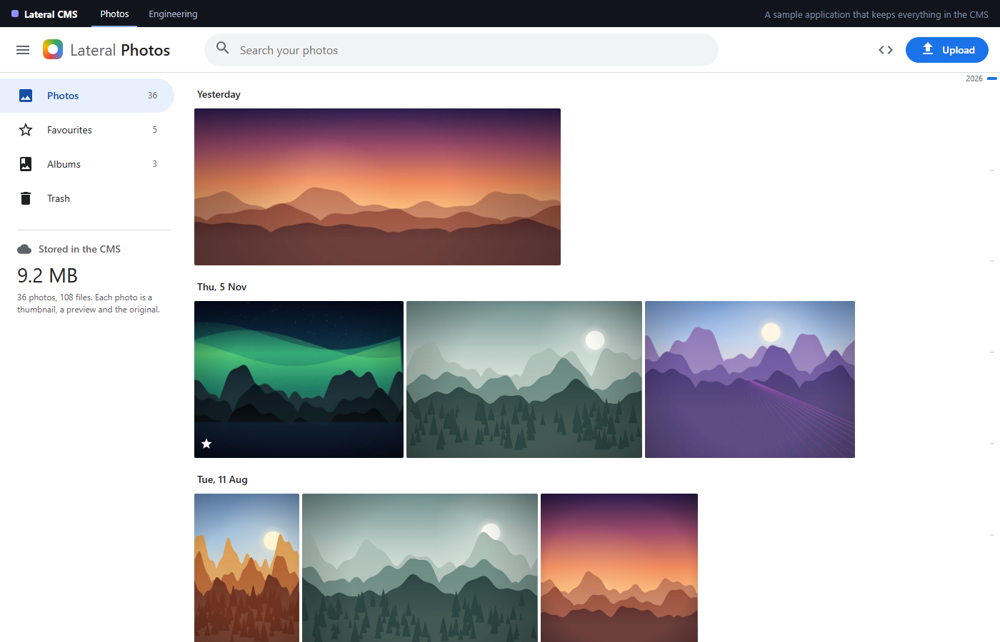

**Lateral Photos is a sample client of the CMS, not part of it.** It is a consumer-style photo library (think Google Photos
without the AI) that keeps everything in the CMS: every photo is a record, every picture an asset that the scanner has cleared. It is
there to show the CMS being used by a real application. It talks to the CMS only through its public API, via the console's
server, which holds the CMS credentials. Sign in as `user` / `password` to see only this side. All the screenshots in this
file are taken from a running copy by `node tools/screenshots/capture.mjs`. How it works and what it does:
[Photo library](#photo-library-a-sample-application).

## See it

All of this is the real application running against a real service. Start it with the commands under [Run it](#run-it) and
open <http://localhost:5100>.

### Lateral Photos, the sample application

| 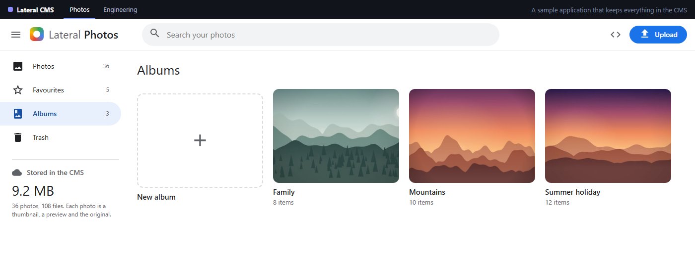 |  |
|---|---|
| **Albums.** An album is a record in the CMS; membership is a list on each photo. | **The viewer.** Arrow keys to move, **i** for details. Large originals come down as parallel ranges and are checked against their SHA-256. |

### The engineering console

A second tab, for testing the service by hand and for explaining it. Every call it makes is shown as curl.

| 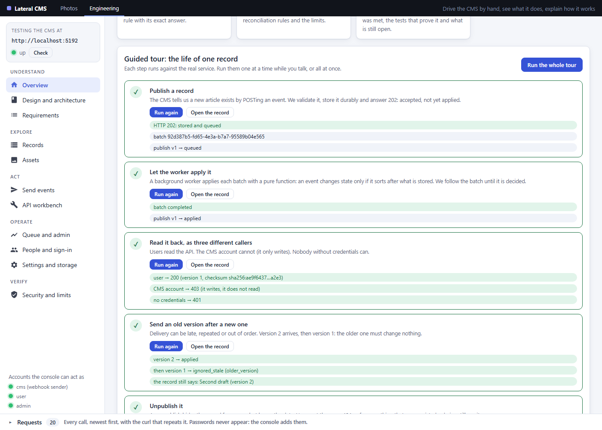 | 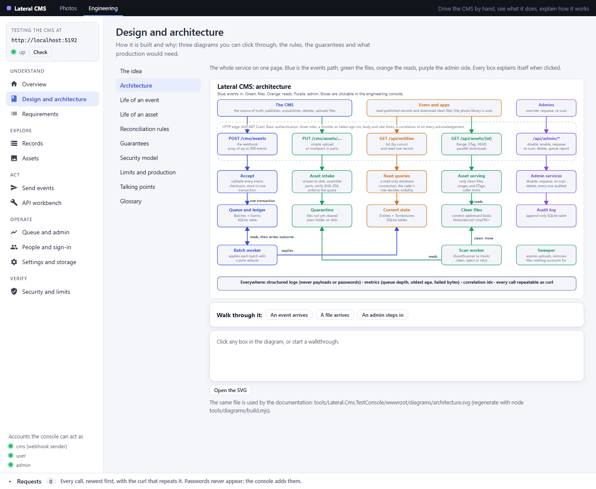 |
|---|---|
| **A guided tour** that walks one record through its life (publish, apply, read as three callers, replay out of order, unpublish, delete) against the real service. | **Architecture,** with clickable boxes and walkthroughs. The diagrams are generated, and a test fails if one points at a file or test that does not exist. |

| 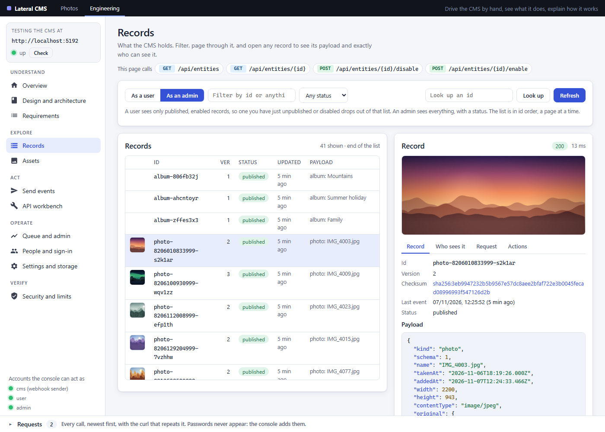 | 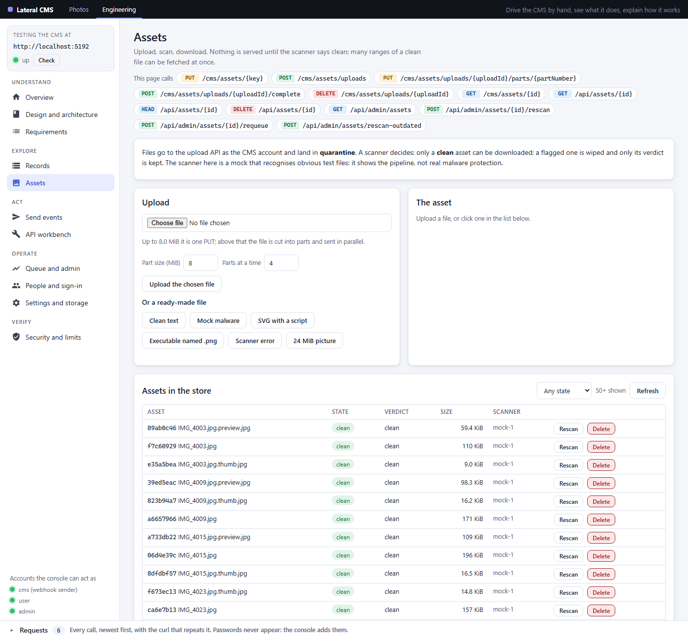 |
|---|---|
| **Records.** Drill into one: its payload, the files it points at, a checksum check, and who can see it. | **Assets.** Upload, watch the scanner decide, download in parallel ranges, administer what is stored. |

| 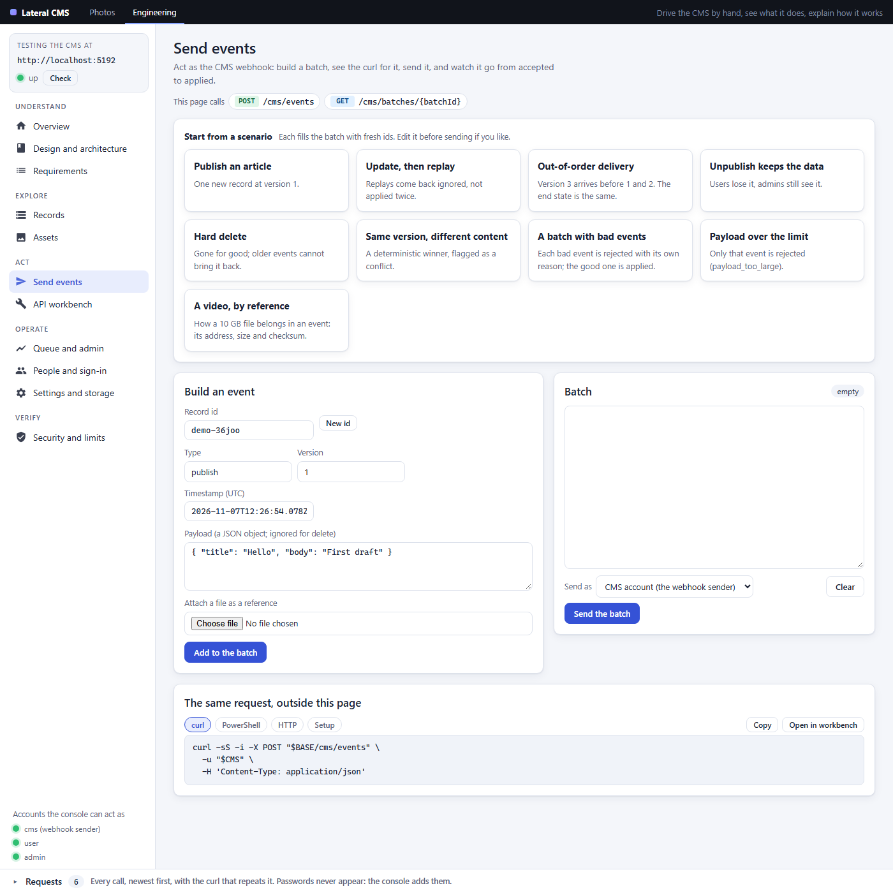 | 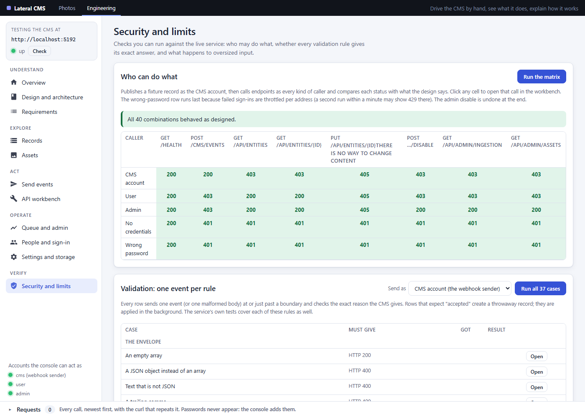 |
|---|---|
| **Send events.** Pick a scenario or build a batch, see it as curl, send it, and watch it go from accepted to applied. | **Security and limits.** Every endpoint as every kind of caller, a validation suite, and oversized-body probes. |

**Requirements.** The original brief word for word beside how each item was met, with the tests and live checks that prove it.
Anything not fully met says so.

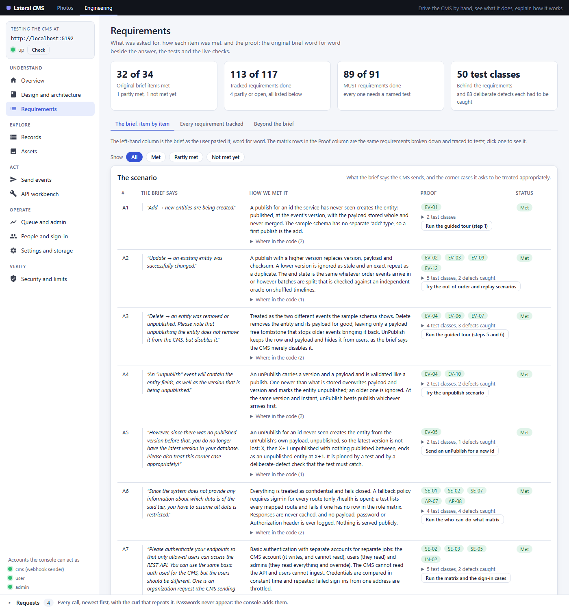

### Running it for real

| 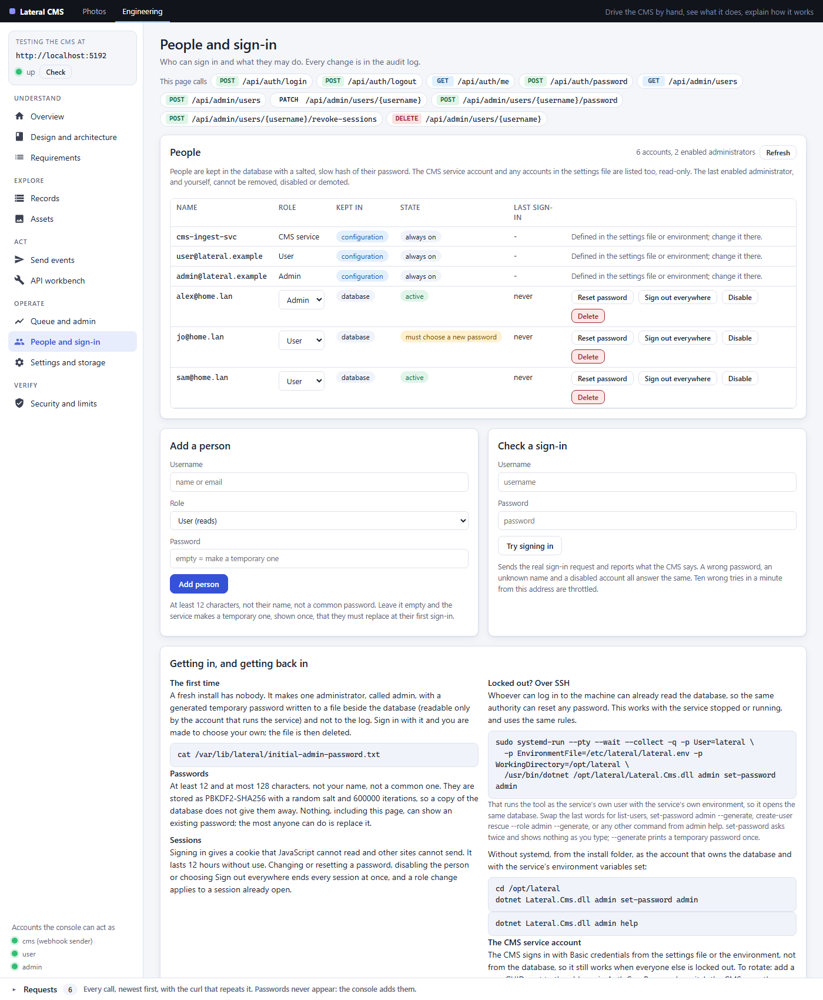 | 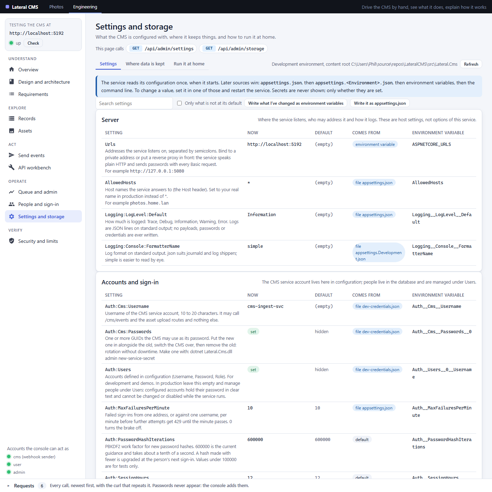 |
|---|---|
| **People and sign-in.** Add, disable, re-role and reset people; check a sign-in; and how to get back in over SSH. | **Settings.** Every setting the service reads, with its value, default, where it came from and what it is for. Secrets show only as set or not set. |

| 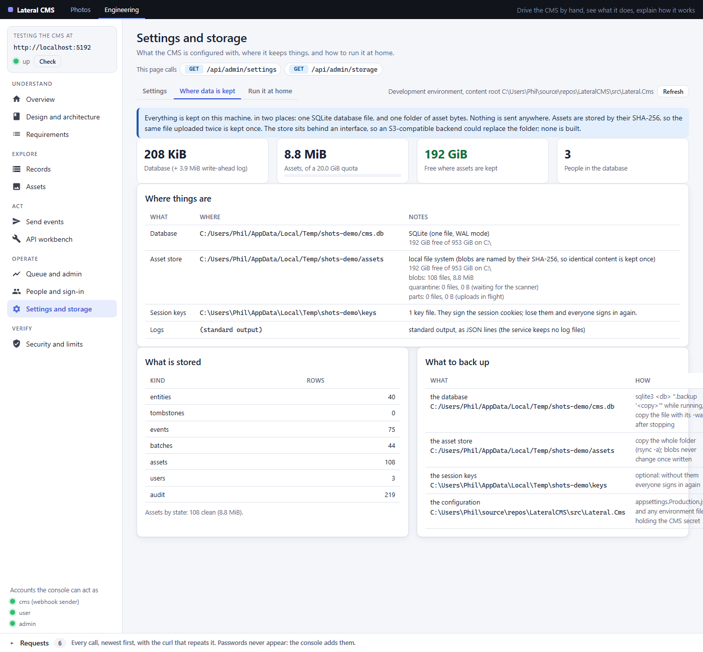 | 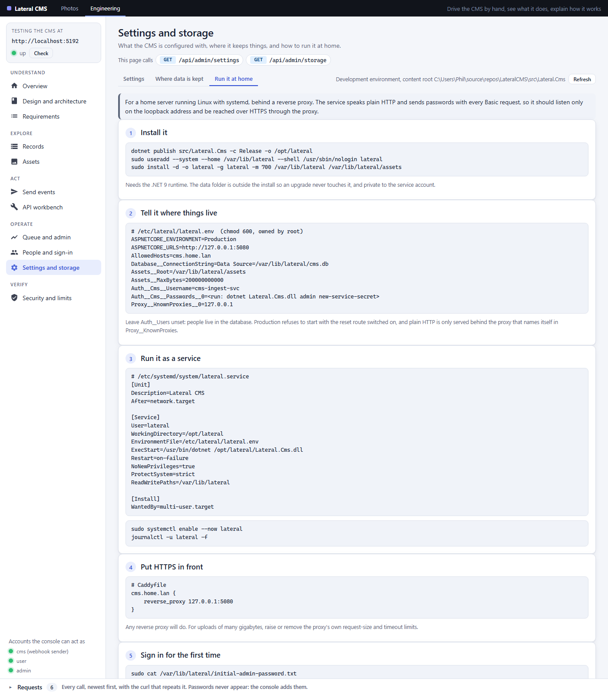 |
|---|---|
| **Storage.** Where the database, assets and keys are, how big and how full, and what to back up. | **Home server.** Install, configure, reverse proxy, first sign-in, back up, upgrade. |


**Contents:** [Set up and run](#set-up-and-run) · [The CMS](#the-cms) · [The photo app](#the-photo-app) · [See it](#see-it) · [Prerequisites](#prerequisites) · [Run it](#run-it) · [Try it](#try-it) · [Accounts](#accounts-sign-in-and-the-operator-command) · [Photo library](#photo-library-a-sample-application) · [Engineering console](#engineering-console) ·
[Tests](#tests) · [Configuration](#configuration) · [Outside Development](#running-outside-development) ·
[Database](#database-and-migrations) · [API at a glance](#api-at-a-glance) · [Known limits](#known-limits) · [Development journey](#development-journey) · [Docs](#docs)

## Prerequisites

- The **.NET 9 SDK** or newer (the projects target `net9.0` and roll forward, so a machine with only .NET 10 also works).
- Windows, macOS or Linux (the build, tests and a home-lab smoke test have been run on Debian 13: [linux-testing.md](linux-testing.md)). Nothing else to install: the database is a SQLite file.
- Optional, for the try-it commands below: `curl` and a POSIX shell (Git Bash on Windows).

## Run it

```bash
dotnet run --project src/Lateral.Cms
```

In the `Development` environment (the default for `dotnet run`) the service listens on <http://localhost:5080>, creates
`src/Lateral.Cms/App_Data/cms.db` and applies the migrations. **No password is committed to the repository.** The first time it
runs in Development it generates random ones into `src/Lateral.Cms/App_Data/dev-credentials.json` (git-ignored; delete the file to
rotate them), unless you supply credentials yourself. The accounts:

| Account | Username | Role | May |
|---|---|---|---|
| CMS (the sender) | `cms-ingest-svc` | `CmsIngest` | post events, follow its batches |
| User | `user@lateral.example` | `User` | list and read published entities |
| Admin | `admin@lateral.example` | `Admin` | read everything, disable/enable, watch the queue |

In Visual Studio, open `Lateral.sln` and pick the **CMS and test console** startup profile.

## Try it

These commands are run by CI against the built service (the `README try-it` job), so they stay true. They need only `curl`
and a POSIX shell (bash, zsh, Git Bash); on Windows without one, use the [engineering console](#engineering-console) or
[requests.http](requests.http) instead. Pipe any response through `jq .` if you have it.

Set up the accounts. The generated credentials file lists three passwords in order (CMS, user, admin) and the usernames are in
the table above, so nothing is typed here (start the service first, so the file exists):

```bash try-it
BASE=http://localhost:5080
PASSWORDS=($(grep -oE "[0-9a-f]{8}(-[0-9a-f]{4}){3}-[0-9a-f]{12}" src/Lateral.Cms/App_Data/dev-credentials.json))
CMS="cms-ingest-svc:${PASSWORDS[0]}"
READER="user@lateral.example:${PASSWORDS[1]}"
ADMIN="admin@lateral.example:${PASSWORDS[2]}"
ID="demo-$(date +%s)"
```

Send a batch as the CMS: a publish, and a publish whose version is invalid. The answer is `202`, **not** "applied": the
batch is stored and queued, and the response (and its `Location` header) tells you where to follow it.

```bash try-it
HEADERS="$(mktemp)"
RESPONSE="$(curl -sf -u "$CMS" -H "Content-Type: application/json" -D "$HEADERS" "$BASE/cms/events" -d "[
  {\"type\":\"publish\",\"id\":\"$ID\",\"version\":1,\"payload\":{\"title\":\"Hello\"},\"timestamp\":\"2024-01-01T00:00:00Z\"},
  {\"type\":\"publish\",\"id\":\"$ID-bad\",\"version\":0,\"payload\":{},\"timestamp\":\"2024-01-01T00:00:00Z\"}
]")"
grep -iE "^(HTTP|location|x-correlation-id)" "$HEADERS"
echo "$RESPONSE" | sed 's/},{/},\n  {/g'
BATCH="$(echo "$RESPONSE" | sed -E 's/.*"batchId":"([^"]+)".*/\1/')"
```

Follow the batch until it is no longer `queued`. Each event shows its final outcome, reason and checksum, never its payload:

```bash try-it
while curl -sf -u "$CMS" "$BASE/cms/batches/$BATCH" | grep -q '"status":"queued"'; do sleep 0.2; done
curl -sf -u "$CMS" "$BASE/cms/batches/$BATCH" | sed 's/},{/},\n  {/g'
```

Read it as a user, then show that nothing is served without credentials and that users cannot post events:

```bash try-it
curl -sf -u "$READER" "$BASE/api/entities/$ID"; echo
test "$(curl -s -o /dev/null -w '%{http_code}' "$BASE/api/entities")" = 401
test "$(curl -s -o /dev/null -w '%{http_code}' -u "$READER" -X POST "$BASE/cms/events" -H "Content-Type: application/json" -d "[]")" = 403
```

Unpublish it. Users stop seeing it, with the same `404` as for an id that never existed; admins still can, with a `status` block:

```bash try-it
curl -sf -u "$CMS" -H "Content-Type: application/json" "$BASE/cms/events" -d "[
  {\"type\":\"unPublish\",\"id\":\"$ID\",\"version\":1,\"payload\":{\"title\":\"Hello\"},\"timestamp\":\"2024-01-01T00:01:00Z\"}
]" > /dev/null
until [ "$(curl -s -o /dev/null -w '%{http_code}' -u "$READER" "$BASE/api/entities/$ID")" = 404 ]; do sleep 0.2; done
curl -sf -u "$ADMIN" "$BASE/api/entities/$ID"; echo
```

Publish again and disable it as an admin. The disable is local: a later publish from the CMS does not undo it.

```bash try-it
curl -sf -u "$CMS" -H "Content-Type: application/json" "$BASE/cms/events" -d "[
  {\"type\":\"publish\",\"id\":\"$ID\",\"version\":2,\"payload\":{\"title\":\"Hello again\"},\"timestamp\":\"2024-01-01T00:02:00Z\"}
]" > /dev/null
until curl -sf -u "$ADMIN" "$BASE/api/entities/$ID" | grep -q '"version":2'; do sleep 0.2; done
curl -sf -u "$ADMIN" -X POST "$BASE/api/entities/$ID/disable"; echo
test "$(curl -s -o /dev/null -w '%{http_code}' -u "$READER" "$BASE/api/entities/$ID")" = 404
```

Finally hard-delete it. The row and its content are removed (the file is wiped, see [DESIGN](docs/DESIGN.md)); only a
payload-free marker remains so that a late, older event cannot bring it back:

```bash try-it
curl -sf -u "$CMS" -H "Content-Type: application/json" "$BASE/cms/events" -d "[
  {\"type\":\"delete\",\"id\":\"$ID\",\"timestamp\":\"2024-01-01T00:03:00Z\"}
]" > /dev/null
until [ "$(curl -s -o /dev/null -w '%{http_code}' -u "$ADMIN" "$BASE/api/entities/$ID")" = 404 ]; do sleep 0.2; done
curl -sf -u "$ADMIN" "$BASE/api/admin/ingestion"; echo
```

## Assets: upload, scan, download

Files do not travel in events. They go to the asset store, a local approximation of an object store: one `PUT` for small files,
**multipart upload** (parts in parallel, each checksummed) for large ones, and **ranged, resumable, parallel downloads**. Every
upload lands in **quarantine**; a background scanner decides; only a **clean** asset can be downloaded, and a flagged one is
overwritten and removed (only its verdict stays). The scanner here is a mock that recognises obvious test patterns: it proves the
pipeline, it is not malware protection. See [DESIGN section 11](docs/DESIGN.md#11-assets-and-scanning).

A small file, then the same thing for a file the mock scanner flags:

```bash try-it
FILE="$(mktemp)"
printf 'An ordinary text file.\n' > "$FILE"
ASSET="$(curl -sf -u "$CMS" -X PUT -H "Content-Type: text/plain" --data-binary @"$FILE" "$BASE/cms/assets/hello.txt")"
echo "$ASSET"
ASSET_ID="$(echo "$ASSET" | sed -E 's/.*"id":"([^"]+)".*/\1/')"
while curl -sf -u "$CMS" "$BASE/cms/assets/$ASSET_ID" | grep -q '"state":"quarantined"'; do sleep 0.2; done
curl -sf -u "$CMS" "$BASE/cms/assets/$ASSET_ID"; echo
curl -sf -u "$READER" "$BASE/api/assets/$ASSET_ID"
curl -sf -u "$READER" -H "Range: bytes=3-9" "$BASE/api/assets/$ASSET_ID"; echo
test "$(curl -s -o /dev/null -w '%{http_code}' -u "$CMS" "$BASE/api/assets/$ASSET_ID")" = 403

printf 'harmless words LATERAL-MOCK-VIRUS-TEST-FILE more words\n' > "$FILE"
BAD="$(curl -sf -u "$CMS" -X PUT -H "Content-Type: text/plain" --data-binary @"$FILE" "$BASE/cms/assets/bad.txt")"
BAD_ID="$(echo "$BAD" | sed -E 's/.*"id":"([^"]+)".*/\1/')"
while curl -sf -u "$CMS" "$BASE/cms/assets/$BAD_ID" | grep -q '"state":"quarantined"'; do sleep 0.2; done
curl -sf -u "$CMS" "$BASE/cms/assets/$BAD_ID"; echo
test "$(curl -s -o /dev/null -w '%{http_code}' -u "$READER" "$BASE/api/assets/$BAD_ID")" = 404
test "$(curl -s -o /dev/null -w '%{http_code}' -u "$ADMIN" "$BASE/api/assets/$BAD_ID")" = 404
```

A large file, the S3 way: start an upload, send the parts (they may be sent in parallel; the [engineering console](#engineering-console) does), and
complete it. Then fetch it back as three parallel byte ranges and check the pieces reassemble to the original:

```bash try-it
BIG="$(mktemp)"
{ printf '\211PNG\r\n\032\n'; head -c 11000000 /dev/urandom; } > "$BIG"
SIZE="$(wc -c < "$BIG" | tr -d ' ')"
UPLOAD="$(curl -sf -u "$CMS" -H "Content-Type: application/json" "$BASE/cms/assets/uploads" -d "{\"key\":\"big.png\",\"contentType\":\"image/png\",\"size\":$SIZE}")"
UPLOAD_ID="$(echo "$UPLOAD" | sed -E 's/.*"uploadId":"([^"]+)".*/\1/')"
split -b 5242880 "$BIG" "$BIG.part."
N=0
for PART in "$BIG".part.*; do
  N=$((N + 1))
  curl -sf -u "$CMS" -X PUT --data-binary @"$PART" "$BASE/cms/assets/uploads/$UPLOAD_ID/parts/$N" > /dev/null
done
PARTS="$(seq -s, 1 "$N" | sed -E 's/([0-9]+)/{"partNumber":\1}/g')"
BIG_ASSET="$(curl -sf -u "$CMS" -H "Content-Type: application/json" "$BASE/cms/assets/uploads/$UPLOAD_ID/complete" -d "{\"parts\":[$PARTS]}")"
BIG_ID="$(echo "$BIG_ASSET" | sed -E 's/.*"id":"([^"]+)".*/\1/')"
while curl -sf -u "$CMS" "$BASE/cms/assets/$BIG_ID" | grep -q '"state":"quarantined"'; do sleep 0.2; done
curl -sf -u "$CMS" "$BASE/cms/assets/$BIG_ID"; echo

curl -sf -u "$READER" -r 0-4999999 -o "$BIG.r1" "$BASE/api/assets/$BIG_ID" &
curl -sf -u "$READER" -r 5000000-9999999 -o "$BIG.r2" "$BASE/api/assets/$BIG_ID" &
curl -sf -u "$READER" -r "10000000-$((SIZE - 1))" -o "$BIG.r3" "$BASE/api/assets/$BIG_ID" &
wait
cat "$BIG.r1" "$BIG.r2" "$BIG.r3" | cmp - "$BIG" && echo "the three parallel ranges reassemble to the original file"
rm -f "$FILE" "$BIG" "$BIG".part.* "$BIG".r1 "$BIG".r2 "$BIG".r3
```

Admins can list assets with their verdicts (`GET /api/admin/assets`), delete one (the bytes are overwritten, then removed), re-scan
one, or re-queue every asset cleared by an older scanner version (`POST /api/admin/assets/rescan-outdated`). If the scanner fails
or hangs, the asset stays quarantined and unserved, retries with back-off, and is finally set aside for an admin: it is never
treated as clean.

## Photo library (a sample application)

A consumer-style photo library, in the spirit of Google Photos without the AI, that keeps **everything in the CMS**. It is the
front page of the console site (`http://localhost:5100`; the engineering console is its second tab):

```bash
dotnet run --project src/Lateral.Cms                 # terminal 1: the service on :5080
dotnet run --project tools/Lateral.Cms.TestConsole   # terminal 2: open http://localhost:5100
```

Upload by button or by dropping files anywhere on the page (JPEG, PNG, GIF, WebP), or choose *Add sample photos*, which draws 36
pictures in your browser and runs them through the same pipeline. Browse a timeline grouped by day with a date rail, select
with a click (shift for a range), open the viewer (arrow keys, **i** for details), star favourites, make albums, search by
month, year, file name, camera or album, move to trash and restore, delete forever, and download originals. *Behind the
scenes* (the `<>` button) shows what the CMS holds and every call the page made.

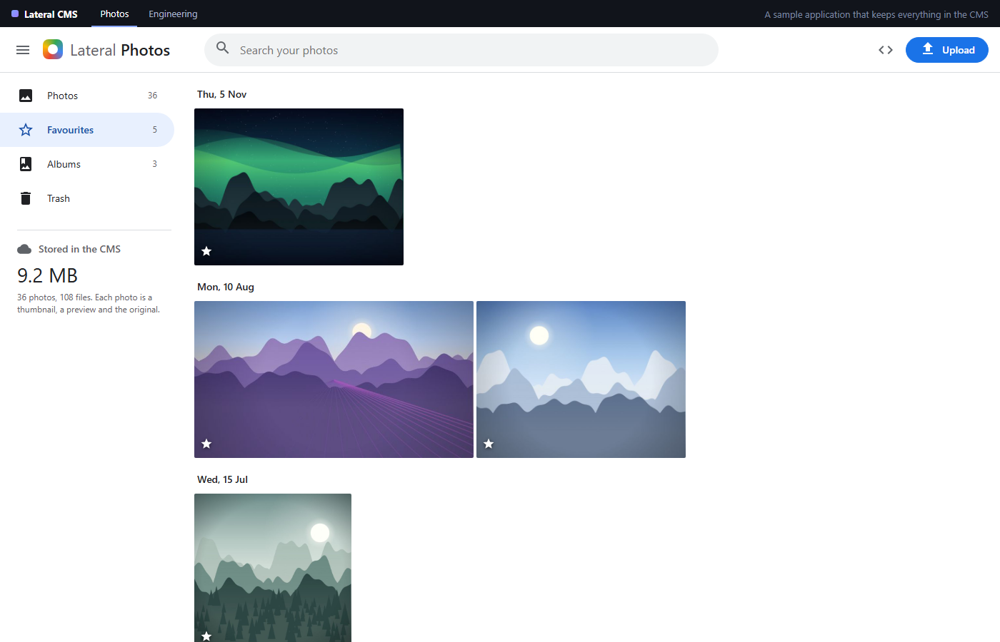

How it uses the CMS:

| In the app | In the CMS |
|---|---|
| A photo | An entity `photo-<reversed time taken>-<random>`. The CMS lists entities in id order, so with the time reversed in the id its own paging returns the library newest first, with no sorting in the page. The payload holds the name, date, size, camera and the ids of the files |
| Its pictures | Three assets: a thumbnail and a preview made in the browser, and the untouched original. Small ones go up in one PUT, large ones as parallel multipart parts; originals over 4 MB come down as four parallel ranges and are checked against the recorded SHA-256 |
| Safety | A photo is added only when all three files have been scanned clean. A file the scanner blocks is wiped and nothing is added; *Test the scanner* in the drawer shows it |
| Favourite, description, album, trash | A new version of the photo's entity (the page shows the change at once and takes it back if the CMS refuses it) |
| An album | An entity `album-<random>`; membership is a list on each photo |
| Delete forever | A CMS `delete` event (the id cannot be resurrected by an older version) and the removal of the three files |
| The same picture twice | Recognised by SHA-256 before anything is uploaded |

The page holds no credentials. It names an account for each call: `cms` to write, `user` to read, `admin` only to remove files for
good. Pictures reach `` tags through `/media/{id}`, a read-only route of the console that fetches the asset as the reader.
Listing is by id, so the page reads the whole library a page at a time; a CMS shared with other content would want a prefix
filter on the listing (not built).

## Engineering console

**Signing in.** The whole console site is behind a sign-in (two accounts with random GUID passwords, generated on first
run into `App_Data/console-credentials.json`): **`admin`** opens everything, and **`user`** opens the photo library only (its pages, its pictures and the few CMS calls it makes; the
engineering pages and every other tool are refused). The session is a signed, expiring, HttpOnly, SameSite=Strict cookie, five
wrong passwords lock a name out for a minute, and there is a Sign out button on every page. Set your own people with
`Console:SignIn:People` (or turn the sign-in off with `Console:SignIn:Enabled=false`, only ever on loopback). Behind a tunnel or
proxy that serves https, the cookie is marked Secure. The console is still a development tool that holds CMS admin
credentials: if you publish it, share only the `user` login, and see "Putting it on the internet" in [docs/OPERATIONS.md](docs/OPERATIONS.md). The CMS service has its own, separate sign-in (see Accounts).

The second tab of the console site, at `/engineering`, is for testing the service by hand and for explaining it. Credentials
stay on the console's server; the page only ever names an account. Every call it makes is shown as the curl (or PowerShell,
or raw HTTP) that repeats it, with the request log docked at the bottom.

```bash
dotnet run --project src/Lateral.Cms                 # terminal 1: the service on :5080
dotnet run --project tools/Lateral.Cms.TestConsole   # terminal 2: the console on http://localhost:5100/engineering
```

| Page | What it is for |
|---|---|
| **Overview** | Is it healthy now (up, worker, queue, failures, counts), where to start, and a **guided tour** that walks one record through publish, read, replay, unpublish and delete against the real service |
| **Design and architecture** | Three diagrams with clickable boxes and a walkthrough for each (the architecture, the life of an event, the life of an asset), the reconciliation rules, the guarantees and the tests behind them, the security model, the limits, talking points and a glossary |
| **Requirements** | The original brief, word for word, beside how each item was met, the requirements and tests that prove it and a live check to try; every one of the tracked requirements, filterable; and what was asked for afterwards. Anything not fully met says so (macOS is not green in CI) |
| **Records** | List what the CMS holds as a user or an admin, filter it, page through it, and drill into one record: its payload, the files it points at, a checksum check, **who can see it** (asked as every caller), the request that fetches it, and what can be done to it |
| **Assets** | Upload (one `PUT`, or parallel multipart parts), watch the scanner decide, download in parallel ranges and verify the hash, and administer what is stored |
| **Send events** | Build a batch from a scenario, the form or by editing the JSON, see it as curl, send it as any caller and watch it go from accepted to applied |
| **API workbench** | Every endpoint, editable (path, query, headers, body, caller), shown as curl, PowerShell or raw HTTP, sent, with the response explained and the obvious next call offered. It remembers the last ids it saw |
| **People and sign-in** | Add, disable, re-role, reset and delete people (a temporary password is shown once), check a sign-in, and how to get back in over SSH |
| **Settings and storage** | Every setting the CMS reads with its value, default, source and purpose; where the database, assets and keys are kept, how big and how full; and a step-by-step guide to running it at home |
| **Queue and admin** | Live queue depth, oldest wait and a trend line; failed batches with requeue; re-scan of assets cleared by an older scanner; the test-only erase (only while `Admin:AllowReset` is on, which is refused in Production) |
| **Testing** | Every test in both suites, grouped by class and area, with a plain-English description, the requirements it proves, pass or fail, time taken and the failure message if there is one; filter by result, area or word. It shows the last recorded run: `bash tools/testing/run.sh` runs both suites and refreshes it |
| **Security and limits** | Who may do what (every endpoint as every caller), a validation suite (one event per rule, at and past each boundary, with the exact reason each must give), sign-in edge cases, and what happens to an oversized body |

The endpoint catalogue behind the workbench is a data file, `wwwroot/endpoints.json`; a service test fails if it stops
matching the routes and roles the service really has. The diagrams are generated by `node tools/diagrams/build.mjs`. The
Requirements page reads `brief-trace.json` (written by hand, with the brief's words verbatim) and `requirements.json`
(generated from `docs/REQUIREMENTS.md` by `node tools/requirements/build.mjs`); tests fail if a quote is not the brief's, if
an item is called met while a requirement it cites is not Done, or if the generated file is stale.

The console listens on loopback only and reaches only an allow-list of the service's routes. In Development it reads the
accounts from the service's generated development credentials, and it refuses to start outside the Development environment
unless `Console:AllowNonDevelopment` is set.


## Tests

```bash
dotnet test                                  # everything; the suites finish in well under a minute
CI=true dotnet build -c Release              # the strict build CI runs: warnings are errors
```

The suite uses the real HTTP pipeline and a real SQLite file per test class (no in-memory fakes), a manual clock, and real
faults produced with database triggers. It covers the reconciliation rules (one test per row of the rule table, both
arrival orders for every tie), order independence against an independent oracle on random shuffles and on every
permutation of the curated timelines, parsing and its limits, the checksum, the acknowledgement-after-commit and
atomic-apply guarantees, retry/back-off/set-aside, the queue cap under concurrent senders, restarts, authentication with
valid and invalid combinations, every role on every route, the log contents, and what a hard delete leaves in the file.

- [docs/REQUIREMENTS.md](docs/REQUIREMENTS.md) maps every requirement to the tests that prove it, and a test fails if a
  MUST requirement has none.
- [docs/EVIDENCE.md](docs/EVIDENCE.md) records the results: counts, the deliberate-defect log
  (`node tools/mutation-check/run.mjs`), and measurements.
- Load smoke: `dotnet run -c Release --project tools/Lateral.Cms.LoadSmoke -- --senders 8 --batches 25 --events 100`
  starts the built service with generated credentials and prints throughput and latency. It measures; it does not assert.

**Exploratory testing.** `tools/explore/probe.mjs` is a 168-check probe of a *running* service (every field at and past its
boundary, reconciliation under concurrent writers, assets and ranges, headers and sign-in); it flags any 5xx. Run it against a
throwaway instance, never one with data you care about; its header says how. The engineering console's **Security and
limits** page runs the auth matrix and a validation suite live, and its **API workbench** shows any call as curl.

## Accounts, sign-in and the operator command


People who sign in live in the database (a salted PBKDF2 hash of the password, never the password). They use the API with a
session cookie (`POST /api/auth/login`) or with Basic credentials, and an administrator manages them in the console
(**People and sign-in**) or at `/api/admin/users`. The CMS service account is separate and stays in configuration.

- **First run.** With nobody to sign in, the service makes an administrator called `admin` with a generated temporary password,
  written to `initial-admin-password.txt` beside the database (readable by the service account only, never logged). Signing in
  with it makes you choose your own, and the file is deleted.
- **In Development** the three accounts (CMS, user, admin) come from `src/Lateral.Cms/App_Data/dev-credentials.json`, which is
  generated on first run and git-ignored; those are configuration accounts, so their passwords are changed by editing or deleting
  that file, not through the API.
- **Locked out, or changing the admin password from the server:** on the machine, run the operator command. It opens the same
  database as the service, with the service stopped or running:

```bash
dotnet run --project src/Lateral.Cms -- admin list-users
dotnet run --project src/Lateral.Cms -- admin set-password admin            # asks twice, shows nothing
dotnet run --project src/Lateral.Cms -- admin set-password admin --generate # prints a temporary one, once
dotnet run --project src/Lateral.Cms -- admin help
```

  (On a server, `dotnet Lateral.Cms.dll admin ...` from the install folder.) The last enabled administrator cannot be removed,
  disabled or demoted; the tool refuses, and `set-password` on them is the way back in.
- **Settings and storage** in the console show every setting with its value, default, source and purpose, where the database and
  assets are kept, and how to run it at home. The full guide, with the systemd unit, reverse proxy, backups and upgrades, is
  [docs/OPERATIONS.md](docs/OPERATIONS.md).

## Configuration

Set in `appsettings.json` or as environment variables (`Ingestion__MaxBatchSize=100`). Invalid values stop startup and
name the setting.

| Key | Default | Meaning |
|---|---|---|
| `Database:ConnectionString` | `Data Source=App_Data/cms.db` | SQLite file, relative to the project folder |
| `Database:ReadConnectionString` | the same file, read-only | could point at a replica |
| `Database:ApplyMigrationsOnStartup` | `true` | |
| `Auth:Cms:Username` / `Passwords` | none | username 10 to 20 characters; each password a GUID; several may be active to rotate |
| `Auth:Users` | none | for development: accounts defined in configuration (`{Username, Password (12+ chars), Role}`), read-only and in clear text. In production leave it empty: people live in the database |
| `Auth:PasswordHashIterations` | 600000 | PBKDF2 work factor for new hashes; lower is for tests |
| `Auth:SessionHours` / `UserCacheSeconds` / `VerifiedCredentialCacheMinutes` | 12 / 5 / 5 | idle life of a session; how long a person's record is trusted (a change made with the operator command shows within it); how long a correct Basic sign-in is remembered |
| `Auth:KeysPath` / `BootstrapAdminUsername` | `keys` beside the database / `admin` | where session-signing keys are kept; the first-run administrator's name |
| `Auth:MaxFailuresPerMinute` | `10` | failed sign-ins per address before `429`; `0` disables |
| `Ingestion:MaxBodyBytes` / `MaxBatchSize` / `MaxPayloadBytes` | 5 MiB / 500 / 256 KiB | refused with `413`, `413`, and a rejected event |
| `Ingestion:MaxJsonDepth` / `MaxFutureSkew` | 32 / 1 hour | the depth counts the whole request (the array and the event are two levels, so a payload may nest about 30) |
| `Ingestion:ChecksumAlgorithm` | `sha256` | `sha256` or `md5` |
| `Inbox:WorkerEnabled` | `true` | tests turn it off and drive the processor |
| `Inbox:PollInterval` / `MaxAttempts` | 1 s / 5 | |
| `Inbox:RetryBaseDelay` / `RetryMaxDelay` / `FaultDelay` | 2 s / 60 s / 5 s | back-off doubles up to the maximum |
| `Inbox:MaxBytes` | 256 MiB | queue size cap; beyond it `429` and nothing is stored |
| `Api:DefaultPageSize` / `MaxPageSize` | 50 / 100 | |
| `Ingestion:MaxConcurrentAccepts` / `AcceptQueueLimit` | 16 / 256 | batches read into memory at once, and how many may wait; overflow gets `429` |
| `Proxy:KnownProxies` / `KnownNetworks` | none | trusted reverse proxies; their `X-Forwarded-For` sets the client address for the throttle (ignored if none) |
| `ApiDocs:Enabled` | `true` | the Swagger page and OpenAPI document at `/swagger`; both need a signed-in caller. `false` makes them `404` |
| `Admin:AllowReset` | `false` | test-only erase endpoint: allowed in Development, in another environment only if `Admin:ResetAllowedEnvironment` names it, never in Production |
| `Assets:Root` | `App_Data/assets` | folder for asset bytes (quarantine, parts, content-addressed blobs) |
| `Assets:MaxSimpleBytes` / `MaxObjectBytes` | 8 MiB / 5 GiB | one `PUT` up to the first; multipart up to the second |
| `Assets:MinPartBytes` / `MaxPartBytes` / `MaxParts` | 5 MiB / 64 MiB / 10,000 | multipart part limits (the last part may be smaller) |
| `Assets:MaxBytes` | 20 GiB | store cap (parts in flight count); beyond it `429` |
| `Assets:UploadTtl` / `SweepInterval` / `SweepGrace` | 24 h / 5 min / 10 min | unfinished uploads expire; the sweeper removes orphans older than the grace |
| `Assets:MaxConcurrentDownloadsPerCaller` | 8 | more open downloads from one caller get `429` |
| `Assets:ScanTimeout` / `ScanMaxAttempts` | 2 min / 5 | a scan that fails or hangs is retried (doubling delay from `ScanRetryBaseDelay` to `ScanRetryMaxDelay`), then set aside |
| `Assets:Scanner` | `Mock` | the only built-in scanner; `Assets:Mock:*` tunes it (`EnableFailureMarkers`, `DetectEicar`, `AllowExecutables`, archive limits) |

Every setting, with its current value, default, where the value came from and what it is for, is also in the console under **Settings and storage** (and at `GET /api/admin/settings`).

## Running outside Development

There are no credentials in `appsettings.json`: the service refuses to start without the CMS account. Supply it as environment
variables (or any configuration source). People are not configured: the first administrator is made on first run (see above).
A home-server setup (systemd, reverse proxy, backups) is in [docs/OPERATIONS.md](docs/OPERATIONS.md). For example:

```bash
export ASPNETCORE_ENVIRONMENT=Production
export Auth__Cms__Username=cms-ingest-svc
export Auth__Cms__Passwords__0=$(uuidgen)
export Database__ConnectionString='Data Source=/var/lib/lateral/cms.db'
dotnet run --project src/Lateral.Cms -c Release
```

Production turns on HTTPS redirection and HSTS. **Basic authentication sends the password with every request, so run it
behind TLS only.** The service is a single instance with a single writer; see [Known limits](#known-limits).

## Database and migrations

SQLite in WAL mode, accessed through EF Core with two contexts: a write context (tracking, the only one that saves) and a
read context (no tracking, opened `Mode=ReadOnly`, throws on save). `secure_delete` is on for every connection, so a hard
delete wipes the bytes from the file rather than only unlinking them. There are two migrations (the core schema, then assets and the audit log), applied at startup. To
change the model:

```bash
dotnet tool restore
DOTNET_ROLL_FORWARD=Major dotnet ef migrations add <Name> --project src/Lateral.Cms --context CmsWriteDbContext --output-dir Persistence/Migrations
```

(`DOTNET_ROLL_FORWARD=Major` is only needed on a machine that has just a newer SDK than the 9.0 tool.)

## API at a glance

**Swagger.** The whole API is described, and can be tried, at `/swagger` (the OpenAPI document is `/swagger/v1/swagger.json`). The browser asks for a
username and password, press **Authorize** to use the same ones for the calls you try. It is read from the routes the service really maps, so
it cannot list one that is gone, and a test fails if a route has no explanation or names the wrong callers. Switch it off with `ApiDocs:Enabled=false`.

| 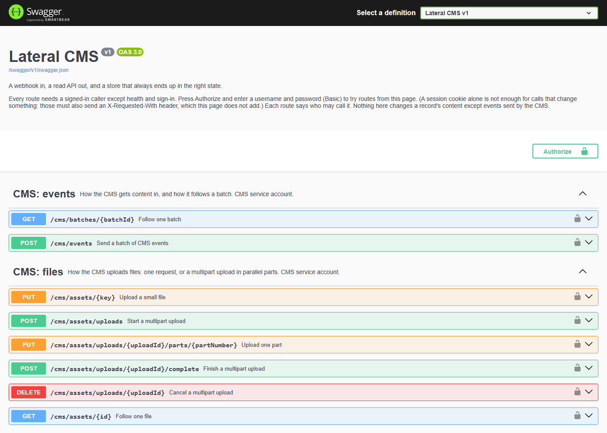 | 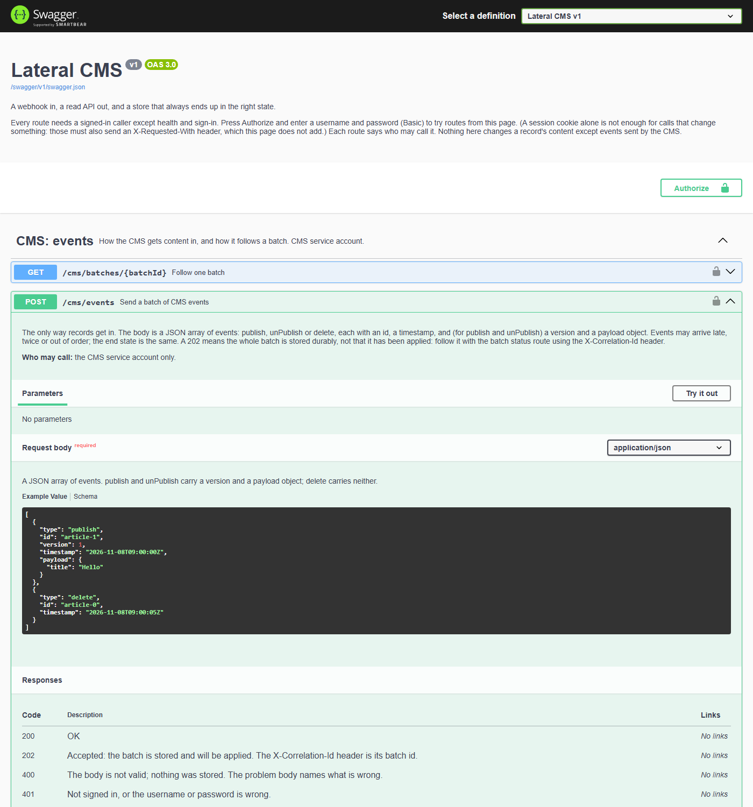 |
|---|---|
| **Every route,** grouped by who uses it; the lock shows it needs a caller. | **One route opened:** what it is for, who may call it, an example you can send, and what each status means. |

| Route | Who | |
|---|---|---|
| `GET /health` | anyone | `{"status":"ok"}` after a database check |
| `POST /cms/events` | CMS | a JSON array of events; `202` + `Location`, or `200` when nothing was left to queue |
| `GET /cms/batches/{id}` | CMS, admin | `queued`, `completed` or `failed`, with each event's outcome |
| `GET /api/entities?limit=&cursor=` and `GET /api/entities/{id}` | user, admin | keyset paging; admins also get a `status` block |
| `POST /api/entities/{id}/disable` and `/enable` | admin | local override, idempotent |
| `GET /api/admin/ingestion`, `POST /api/admin/ingestion/{batchId}/requeue` | admin | queue depth and age; put a failed batch back |
| `PUT /cms/assets/{key}`, `POST /cms/assets/uploads`, `PUT .../parts/{n}`, `POST .../complete`, `DELETE .../uploads/{id}` | CMS | upload: one `PUT`, or multipart with parts in parallel |
| `GET /cms/assets/{id}` | CMS, admin | state, checksum and scan verdict; never the bytes |
| `GET`/`HEAD /api/assets/{id}` | user, admin | download a **clean** asset: `Range`, `ETag`, `If-None-Match`, parallel ranges |
| `DELETE /api/assets/{id}`, `GET /api/admin/assets`, `POST /api/admin/assets/{id}/rescan` `/requeue`, `POST /api/admin/assets/rescan-outdated` | admin | administer assets |

Whole-request errors are problem+json with a stable `code` (`invalid_json`, `invalid_batch`, `payload_too_large`,
`batch_too_large`, `inbox_full`, `storage_unavailable`, ...); per-event outcomes are `applied`, `ignored_stale`,
`ignored_duplicate`, `ignored_unsupported_type`, `rejected` (and `queued`) with a reason code. A bad event never fails
the batch, because a webhook sender retries a failed batch forever. The full contract is in [DESIGN](docs/DESIGN.md).

## Known limits

In order of importance (the reasoning and the next step for each is in [DESIGN](docs/DESIGN.md#limits)):

1. **One instance, one writer** (SQLite). Throughput is bounded by it; see EVIDENCE for what was measured. Scale-out needs a
   server database and several workers claiming batches.
2. **Ordering holds under one assumption:** for one id, a higher version never carries an earlier timestamp, and ids are not
   reused with restarting versions. Outside it, arrival order can matter; both counterexamples are pinned by tests.
3. **The CMS account's secret is in configuration and travels as Basic credentials.** People are hashed and have sessions, but
   for the CMS (as the brief requires) use a secret store, signed requests and TLS at the edge. No multi-factor sign-in.
   The photo library and engineering console are development tools (loopback only, fixed accounts, no sign-in page).
4. **"Hard delete" covers the live database file only.** Backups, replicas and WAL archives need their own erasure policy;
   there is no encryption at rest and no retention job for the event history.
5. **The scanner is a mock.** It proves quarantine, verdicts, wiping and fail-closed retry, but recognises only obvious test
   patterns: it is not malware protection. A real engine goes behind the `IAssetScanner` seam. The asset store is one folder on one
   disk, not an object store (no replication, versioning or encryption).
6. **No resync or replay.** A batch that never arrives is visible only as a gap; the CMS would need to send sequence numbers.
7. **.NET 9 leaves support on 10 November 2026.** The projects target `net9.0` and roll forward, so moving to `net10.0` is a
   one-line change in `Directory.Build.props`.

## Development journey

The email invites using LLMs, and this was built with Claude Code. In outline:

1. **A first prototype.** It worked (about 360 service tests and 100 console tests), but it had grown sideways: synchronous
   first with asynchronous processing bolted on, two event tables, four migrations, six overlapping documents, and a console
   wrapped around the core.
2. **A brief, as the starting context.** Rather than patch it, I had Claude write down what it had learned in
   [docs/REBUILD-BRIEF.md](docs/REBUILD-BRIEF.md): the original assignment word for word, the decisions already settled, a
   target design, a requirements matrix, and the standard of evidence every claim must meet. Writing it also turned up real
   problems in the prototype (a rule that only held while a higher version never carried an earlier timestamp, and a "hard
   delete" that left payload bytes in the SQLite file).
3. **This version.** A fresh session rebuilt the service from that brief in phases, stopping at an evidence gate after each.
   The result is one durable asynchronous pipeline, a smaller core, and nothing asserted without a test that was seen to fail
   when the behaviour was broken (the [mutation log](docs/EVIDENCE.md) plants 96 deliberate defects). The asset store, the
   photo app, the engineering console, accounts and the website sign-in were added on top, and the
   [requirements page](#engineering-console) says plainly what is still only partly met.

I reviewed plans and decided what was committed; the tests, the mutation checks and the CI runs, not the model's say-so, are
the evidence.

## Docs

The documentation table is under [The CMS](#documentation-for-the-cms).
